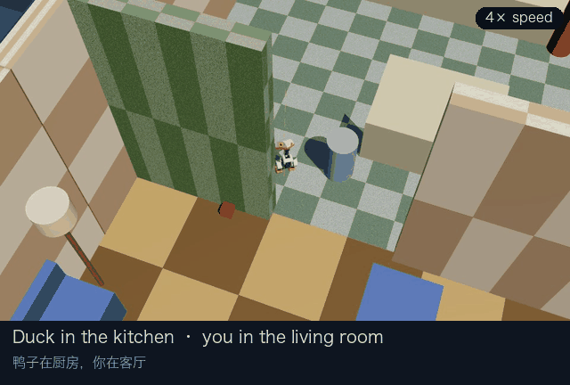

# duck-chat · 鸭子屏幕

在浏览器里看 3D 仿真鸭子，用自然语言和它聊天、指挥它。鸭子本体是 [microduck](https://github.com/pollen-robotics/microduck)
的官方仿真（`scripts/duck-sim`）：真实的 robotd、真实的神经网络策略，身体在 MuJoCo 里。
大脑是本地 Ollama 里的大模型（默认 `qwen3.5:9b-mlx`），不联网、不花钱。



*你在客厅说“过来”，在厨房的鸭子自己规划路线穿过门，停在你面前。官方仿真里录制，4 倍速。*

## 启动

[English](README.md) · 中文

```bash
./setup.sh   # 只需一次：在旁边克隆两个官方仓库、编译、装依赖、打补丁、下载大模型（可以重复运行）
./start.sh   # 启动无窗口的仿真（默认公寓场景）+ 鸭子屏幕；Ctrl+C 两个一起关
```

需要：macOS（Apple 芯片）或 Linux、git、[uv](https://docs.astral.sh/uv/)、Rust 1.89+、[Ollama](https://ollama.com)（可选，
没有就退回关键词模式）。脚本默认把官方仓库放在本仓库的上一级目录，可以用 `DUCK_HOME` 改。

也可以手动分步启动：

```bash
cd ../microduck && DUCK_SIM_SCENE=apartment DUCK_SIM_VIEWER=0 scripts/duck-sim
cd ../duck-chat && DUCK_SIM_SCENE=apartment ./run.sh
```

然后打开 http://127.0.0.1:8765 。拖动旋转视角，右键拖动平移，滚轮缩放，「视角复位」回到默认视角。
左上角显示鸭子状态、正在用的模型和渲染帧率。

3D 画面由浏览器用 WebGL（three.js）按屏幕原生分辨率渲染，相机自动跟随鸭子。
three.js 和 MediaPipe 从 jsDelivr CDN 加载、手势/人脸模型从 Google 的模型仓库加载，所以第一次打开需要联网。

关掉：`./start.sh` 的终端按 `Ctrl+C`（手动分步启动的话，再在 microduck 目录运行 `scripts/duck-sim down`）。

`run.sh` 用的是 `microduck_rl` 的 venv（mujoco / numpy / Pillow / 场景文件都在那里），
默认位置 `~/Pollen/microduck_rl`，和 `duck-sim` 一致；放在别处时设 `DUCK_SIM_RL`。

## 住进房子：官方公寓场景

`microduck_rl` 自带一套公寓（`apartment.xml`）：厨房、客厅、走廊、卧室、书房、浴室，约 7×6 米，墙高 1.6 米，
家具多在 50 厘米以下（鸭子的尺度），门洞故意不对称（官方用来做视觉定位 MCL / RTAB-Map），还有 3 个球和 4 个箱子。

```bash
# 仿真和鸭子屏幕都要设同一个 DUCK_SIM_SCENE（规则和 scripts/duck-sim 一样：名字 / 路径 / 留空 = 空地）
cd ../microduck && scripts/duck-sim down
DUCK_SIM_SCENE=apartment DUCK_SIM_VIEWER=0 scripts/duck-sim
cd ../duck-chat && DUCK_SIM_SCENE=apartment ./run.sh
```

- **一份房子，两个用途**：物理（碰撞）和画面都来自同一个场景文件——`pose.py` 把墙、地板、家具（方块/圆柱/球/胶囊，
  带材质颜色和贴图平铺）导出给浏览器，贴图从 MuJoCo 模型里取原始像素转成 PNG（`/api/tex/<n>.png`）。
- **挡住鸭子的墙自动变透明**：每帧从相机向鸭子打一条射线，挡在中间的墙淡成 15% 不透明度。
- **会动的东西实时跟上**：球和箱子的位置每帧推给浏览器。这需要仿真提供它们的姿态——鸭子自己的 `read`
  只给机器人能感知的东西，所以**本地给 `microduck_rl/src/mjlab_microduck/sim/body_server.py` 加了一个只读的
  `objects` 接口**（17 行，补丁在 `patches/`，`setup.sh` 会自动打上；已向官方提交 [microduck_rl#83](https://github.com/pollen-robotics/microduck_rl/pull/83)）。没有这个接口时，
  会动的东西停在初始位置，不会报错。
- 墙是实心的（碰撞属性和鸭子一致）：鸭子会被挡住，但一直顶着墙走会摔倒（摔倒后会自己爬起来）。

### 认识房子：地图、找路、地点（`navmap.py`）

启动时从同一份场景文件生成地图（5 厘米一格，公寓约 0.01 秒）。一格能走 = 下面有能踩的地板（顶面在地面高度、
有碰撞）**并且**鸭子身高（30 厘米）以内没有障碍；障碍再向外膨胀 0.16 米（半个身宽 + 余量），离障碍 0.35 米以内加代价，
让路线走在过道中间。公寓走廊里有个**楼梯井**（地板空缺、台阶往下），自动被标成不能走。

- **房间**：场景里 `floor_<名字>` 的地板块（7 个：厨房、客厅、书房、卧室、浴室、走廊、走廊南头）。装饰地板只铺了一部分，
  所以每一格的归属是从各块地板出发、沿没有墙的格子往外扩（被墙隔开的不会归错）。
- **地点**（29 个）：每个房间离墙最远的点，加上有名字的家具旁边最近的能走的点（沙发、床、冰箱、书桌、浴缸、马桶……
  客厅角落的**充电座是它的窝**）。中文名在 `navmap.py` 的 `ROOM_LABELS` / `PLACE_LABELS`。
- **找路**：A*（8 邻接，不斜切墙角）+ 视线剪枝成几个拐点，跨房间一条路约 15–45 毫秒。
- **跟路线走**（`actions.py` 的 `_navigate`）：盯着路线前方 0.25 米的点边走边修正；要去的方向偏 70° 以上就
  **先原地转过去再走**（窄地方边走边转会顶到家具）；偏离 0.3 米或每 4 秒重新规划（主人可能在走动）；
  3 秒几乎没前进算卡住 → 原地转向最空的方向、挪开半秒、重新规划，连续 3 次就停下说“过不去”；
  路上摔倒 → 当场爬起来、重新规划，摔 3 次就不走了。正在走的路线会画在页面的地板上（橙色虚线）。
- **原地转身**（`_pivot_to`，闭环看朝向）：仿真实测右转（vx 0.15, vyaw -1.2）很可靠，3 次 -178°/-180°/-176°、
  只漂 0.15 米；左转有时几乎不转（162°/15°/155°），所以左转 1.5 秒没动静就改往右绕。“看着我”也用它：
  主人在身后 0.5 米，3 秒原地转过来，只挪 0.13 米。

实测（公寓，仿真）：

| 场景 | 路线 | 结果 |
|---|---|---|
| 主人在卧室、鸭子在客厅，说“过来” | 客厅 → 走廊 → 卧室 | 63 秒，停在离主人 0.38 米处，离障碍最近 0.18 米，没摔 |
| 主人站在房子外面（书房外墙外），说“过来” | 客厅 → 走廊 → 书房 | 72 秒，停在墙边离主人最近的地方，没摔 |
| 回窝（窝在书架和电视柜之间的窄角落） | 客厅内 | 12 秒，离窝 0.44 米（地点 0.45 米内算到） |
| 书房 → 卧室 | 书房 → 走廊 → 卧室 | 32 秒，离目标 0.23 米 |
| 大模型选地点（bench.py，DUCK_SIM_SCENE=apartment） | — | 34/34（去厨房、回窝睡觉、去沙发那儿等我、go to the kitchen…） |

用到导航的地方：
- 说 / 勾手叫它**过来**：找路走到你面前 0.6 米（你在墙外、墙里时走到离你最近的能走的地方）。
- 大模型多了 **`go_to(place)`** 工具（地点从地图来）：去厨房、去沙发那儿、回窝……
- 它自己溜达：在**同一个房间里**挑一个能走的点溜过去（不会去撞墙、掉楼梯井）；困了先**回窝**再坐下打盹。
- 大模型的“嘴巴”知道它在哪个房间、你在哪个房间。

**摔倒后怎么爬起来（实测）**：`robot.enable` 对倒地的鸭子没用；要先 `sit_toggle` 收进坐姿、再 `sit_toggle` 起身
（躯干 0.063 → 0.121 米）。之前“摔倒自己爬起来”其实没生效，现在改对了。

已知问题：
- **有的物体会掉出世界**：实测 7 个里 obj_1 和 ball_2 一开始就穿过地板/被弹飞。公寓的地板只有 5 毫米厚，
  而仿真为了配合行走策略用 5 毫秒的物理步长（`body_server.py` 注释说明不能改），初始有重叠的小物体会穿透。
  画面上掉到地下 1 米以下的物体不画。

## 像宠物一样：它知道你在哪、有心情、会自己找事做（`life.py`）

**你在鸭子世界里的位置 = 3D 视角（相机）的位置。** 相机现在是“站在房间里的你”：位置不动、只转头盯着鸭子，
鸭子走太远（> 3 米）你才跟上，太近（< 0.35 米）退后一点。你拖动/缩放视角 = 你在房间里走动，鸭子知道。

每秒 10 次综合「你在哪 + 摄像头看到什么 + 心情」决定它的样子，不经过大模型：

| 情境 | 鸭子的反应（仿真里都验证过） |
|---|---|
| 你在它侧后方（> 50°）1.5 秒 | 边走边转过身来面对你（离你 0.7 米以内不转，否则会绕着你打圈） |
| 你在身边（摄像头看到你 / 30 秒内聊过天 / 动过视角） | 一直盯着你看；摄像头里手/脸动，它的视线跟着在你身上移动 |
| 说「过来」/ come here | 边走边修正方向，走到离你约 0.6 米停下 |
| 说「看着我」 | 转过身来面对你 |
| 你离开摄像头 8 秒以上 | 疑惑地叫一声、转身找你（每 18 秒一次） |
| 你回来 | 打招呼、转向你，离得远就凑过来；开心值 +0.3 |
| 手很近、慢慢动（摸它） | 咕咕叫，身体前倾并往一边蹭；开心值上升 |
| 手飞快挥过 | 惊叫，身体后仰 |
| 你的脸 1 秒内明显变大（凑近镜头） | 疑问地叫一声，歪头，身体前倾 |
| 陪着你但没事做 | 每 15–30 秒撒个娇：叫一声歪歪头、点点头、咕咕；你离 1.8 米以上就凑过来 |
| 45 秒没人理 | 自己溜达：走几步、转个弯（离你超过 3 米就往回走） |
| 精力耗尽（约 2.5–3 分钟没人理） | 咕一声，坐下打盹；你一说话/出现就站起来打招呼 |
| 摔倒 | 惊叫，自己爬起来 |
| 它在说话 | 头一下一下地点（1.8 Hz，±0.12 rad） |
| 你问问题（？/ 吗 / 什么 / what…） | 歪头 2 秒 |

谁说了算：你的指令（聊天/手势）会打断它自己的行为；你让它“看左边”时，它 3 秒内不盯着你。
大模型的“嘴巴”能看到它的心情、你在哪、最近发生的事（比如“主人离开了 23 秒刚回来”“刚被摸了”），会自然地提起。

身体限制决定了这些写法（都是仿真实测）：不能原地转（只能边走边转）；下蹲几乎看不出，所以用前倾/后仰/歪身表达；
模型里没有嘴巴关节，说话用点头表现。

**姿态的坑（robotd 源码确认）**：`robot.pose` 的 `active: true` 不会过期，鸭子会一直留在“摆姿势”模式，
而这个模式下站立时的走路速度被强制清零（`control.rs`：`if body_active { c.twist = [0.0; 3]; }`）——
表现就是“下了走路指令，鸭子没反应”。所以 `duck_client.py` 在走路/做技能前会先发 `active: false` 退出，
`life.py` 的表情结束后也会先慢慢摆正、再退出。

## 摄像头：实时跟随你的手和脸

点左上角「📷 摄像头」。浏览器用 MediaPipe（0.10.14，GPU）实时识别手和脸，**视频不离开这台电脑**；
识别结果每秒约 20 次发给 `/api/track`，由 `tracker.py` 直接驱动鸭子，不经过大模型。

| 你做什么 | 鸭子的反应 |
|---|---|
| 在镜头前移动手（没有手时用脸） | 它盯着你，视线跟着你的手/脸在你身上移动（你的右手边 = 它面对你时的左边） |
| 手很近慢慢动 / 飞快挥过 / 脸凑近 | 被摸、吓一跳、好奇（见上一节） |
| ✋ 交警式“停”：竖着的手掌靠近镜头、举着不动 1 秒 | 停下，清空后面的动作 |
| 🫴 勾勾手：手不动，手指一弯一伸 2 个来回以上（四指或只用食指） | 叫一声，转向你走过来 |
| 👍 竖大拇指（保持 0.7 秒） | 开心地咕咕叫 |
| ✌️ 比耶（保持 0.7 秒） | 向前翻滚 |
| 🤟（保持 0.7 秒） | 打招呼 |

手势识别用的不只是 MediaPipe 的分类，还有 21 个关键点算出的手指细节（浏览器算好随每帧发来）：

| 特征 | 怎么算 | 用来分清 |
|---|---|---|
| 伸展度 `curl` | 四指指尖到手腕的平均距离 ÷ 手掌长（张开约 2，握拳约 1） | 勾勾手（来回摆动）vs 握一次拳 vs 张开 |
| 食指伸展度 `icurl` | 食指尖到手腕 ÷ 手掌长 | 单指勾勾手 |
| 手指朝上 `upright` | 中指尖比手腕高几个手掌长（> 1 = 竖着的手掌） | 交警式停 vs 平着的手（摸它） |
| 漂移 | 保持手势期间手的位置变化范围 | 举着不动（停）vs 摸、比划、挥手 |

为什么这么严：MediaPipe 把几乎任何张开的手都认成 Open_Palm（用户实测：手一出现就被当成“停”，打断了刚下的指令）。
摄像头小窗里会实时显示伸展度/食指/朝上/大小的读数，阈值都在 `tracker.py` 顶部，可以对照着调。
所有手势要求置信度 ≥ 0.75；触发后同一手势冷却 2 秒、要放下再做才会再次触发。

摄像头开着时聊天，会附带一张当前画面（384 宽、镜像）给本地大模型的“嘴巴”，所以可以问“我手里拿的是什么”。
带图时回复会慢 2–4 秒（模型要先看图）。

实测延迟（`tracker.py` 注释里有参数）：

| 环节 | 耗时 |
|---|---|
| 浏览器识别一帧（M3 Pro，GPU，预热后） | 手 4.7 ms，脸 3.3 ms；打开后第一帧要编译 GPU 着色器，约 0.3 秒 |
| `/api/track` → robotd 的转头目标 | 10–20 ms |
| 鸭子头部自身：从收到目标到转过一半 | 约 220 ms（直接给 robotd 发 `robot.head` 也是如此，是策略 + 舵机的响应速度） |
| 合计：手跳到另一侧，头转过一半 | 约 0.25–0.3 秒 |

## 配置（环境变量，都有默认值）

| 变量 | 默认 | 作用 |
|---|---|---|
| `DUCK_LLM_MODEL` | `qwen3.5:9b-mlx` | Ollama 模型名，需要支持 tools（看图还要 vision） |
| `DUCK_LLM_URL` | `http://127.0.0.1:11434` | Ollama 地址 |
| `DUCK_LLM_THINK` | `0` | `1` 打开模型的思考模式（更准但更慢） |
| `DUCK_BRAIN` | `llm` | `rules` 只用关键词模式，不用大模型 |
| `DUCK_CHAT_PORT` | `8765` | 网页端口 |

## 大脑怎么工作

一句话分两步处理（`brain.py`）：

1. **身体**：简短的控制提示词 + 工具，temperature 0.1，只决定动作（走、转、坐、站、看、叫、技能），
   决定后立刻交给动作队列，鸭子马上开始动。做不到的事（后退、跳、飞）调用 `cannot_do`，不拿别的动作凑数。
2. **嘴巴**：完整人设，不带工具，被告知身体刚做了什么和实时身体状态，流式地回话。

为什么拆开：9B 级的小模型在同一次回答里既要像朋友一样聊天、又要精确调用工具，会互相干扰——
人设一丰富就开始“嘴上答应、身体不动”。两边也各自保存历史：身体保存真实的工具调用
（存成文字的话，模型会模仿文字、不再调用工具），嘴巴保存聊天文字。

- **“停”不经过大模型**：含“停 / stop / 别动”的话直接取消动作队列，立即生效。
- Ollama 没开或出错时，自动退回关键词模式（`commands.py`），回复里标明“规则模式”。
- 动作按顺序执行（`actions.py` 的 `ActionQueue`）：每个动作按实测时长等它做完再做下一个。

### 实测（M3 Pro 36 GB，qwen3.5:9b-mlx，`python bench.py`）

25 句测试（指令、组合指令、能做和做不到混在一句、按步数走、闲聊、英文），分“每句独立”和“连续对话”两种；
英文提问必须用英文回答才算通过：

| | 工具调用准确率 | 开始动作（中位数） | 完整回复（中位数） |
|---|---|---|---|
| 每句独立 | 25/25 | 2.5 秒 | 5.1 秒 |
| 连续对话 | 25/25 | 3.2 秒 | 6.1 秒 |

通过网页实测：鸭子 1.4–2.7 秒开始动，之后约 0.5 秒出现第一个字，3–4 秒说完；“停”即时生效。
冷启动（第一次把模型载入内存）约 12 秒。

换模型对比：`DUCK_LLM_MODEL=其他模型 ~/Pollen/microduck_rl/.venv/bin/python bench.py`。

## 鸭子能做的动作

| 动作 | 说明 |
|---|---|
| 向前走 | 可以按步数、米数或秒数说（“走 5 步 / 走一米 / 走 5 秒”），由代码按实测步频换算，不让模型算；一次最少 1 秒、最多 20 秒 |
| 转弯 | 边走边转，默认 90°；掉头 180°，转一圈 360° |
| 停 | 立即停下并清空后面的动作 |
| 坐下 / 站起来 | 摔倒时“站起来”会重新启用策略 |
| 翻滚 / 踢左脚 / 踢右脚 / 捡东西 | 一次性技能 |
| 看左 / 右 / 上 / 下 / 前 | 转头看并保持 3 秒 |
| 叫 | greet / chirp / coo / inquire / alarm |

关键词模式下的说法见 `commands.py` 或在页面输入「帮助」。

## 已知问题

- 嘴巴偶尔说错数字或细节（把 0.6 米说成“六米”）。“身体刚做了什么”已附在用户这句话后面，
  连续对话里“身体做了却说做不到”的情况在最近一轮测试里没再出现。
- 小模型偶尔会在“后退”这类做不到的请求上误调用 `walk_forward`（改成两段式 + `cannot_do` 后的 40 次测试里没再出现）。
- 大模型推理和网页 WebGL 渲染都用 GPU，推理时 3D 画面可能掉帧，未在真实前台浏览器里测过。

## 实测得到的身体限制（alpha 策略，仿真）

- 速度指令 0.15 m/s 时原地踏步，0.3 才会真正前进（稳态约 0.12 m/s）；0.5 会明显跑偏。
- 走的是小碎步：约 4.6 步/秒，每步约 2.6 cm，所以“走 5 步”只有约 1 秒、十几厘米。
- 不会后退、不会横移（策略没学过）。
- 原地转方向不稳定，所以转弯都是边走边转；左转约 39°/s、右转约 50°/s，
  角度是近似的（90° 实测 86–100°，掉头实测约 150°）。
- `kick_right` 在仿真里腿几乎不动（robotd 有执行，策略本身动作很小）；`kick_left` 正常。
- 仿真的声音不一定能从 Mac 扬声器听到；页面上会显示鸭子的回复气泡。

## 结构

| 文件 | 作用 |
|---|---|
| `brain.py` | 大模型大脑：身体（工具调用）+ 嘴巴（流式回话，可带摄像头画面），调用 Ollama `/api/chat` |
| `navmap.py` | 从场景生成地图（能走的格子、房间、地点），A* 找路 |
| `life.py` | 鸭子的“生命”：你在哪、心情、注意力、自主行为、头和身体的表情；10 Hz，不经过大模型 |
| `tracker.py` | 摄像头感知：手/脸的位置、大小、速度，摄像头开没开；手势 → 即时动作 |
| `actions.py` | 鸭子的动作，以及按顺序执行它们的 `ActionQueue`；关键词模式和大模型共用 |
| `commands.py` | 关键词模式：大模型不可用时的后备 |
| `duck_client.py` | robotd 的 JSON-RPC 客户端（Unix socket `~/.cache/duck-sim/duck.sock`）。`move`/`head` 是持续意图，各走各的通道（转头不会顶掉走路），后台线程 10 Hz 重发、新目标立即发出；robotd 停收 500 ms 自动归零 |
| `pose.py` | 启动时从和仿真同一份场景导出鸭子的网格（约 7.6 MB）、房子的静态几何和贴图（浏览器只下载一次）；运行时从 duck-body（TCP 7801）只读鸭子和会动物体的姿态，以约 45 Hz 推给浏览器 |
| `server.py` | 标准库 HTTP 服务：页面、`/api/scene`、`/api/meshes.bin`、`/api/pose`（二进制姿态流）、`/api/say`（NDJSON 事件流）、`/api/status` |
| `static/index.html` | 鸭子屏幕页面：three.js 渲染 + 聊天面板（流式显示回话） |
| `bench.py` | 大模型测速与工具调用准确率 |
